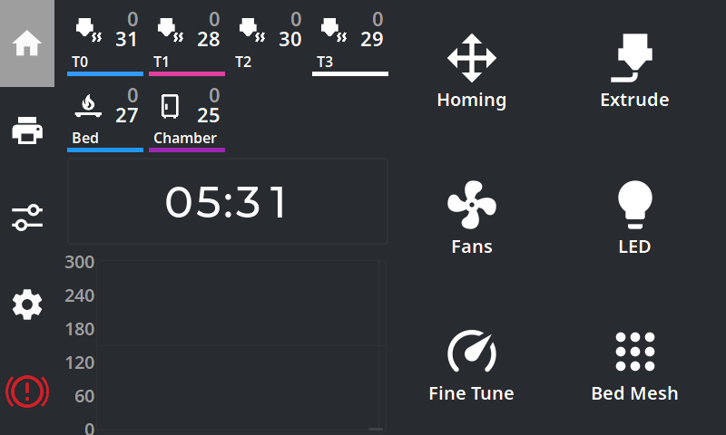
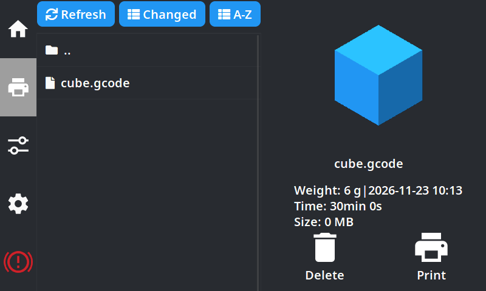
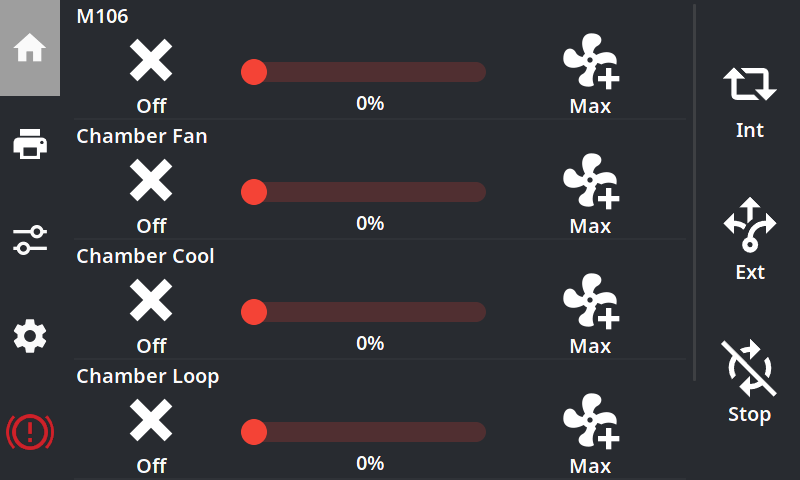
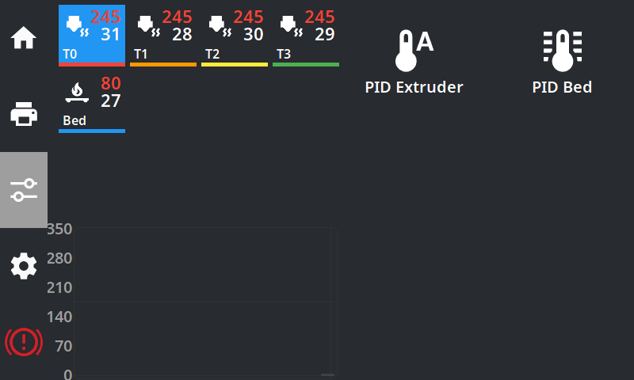
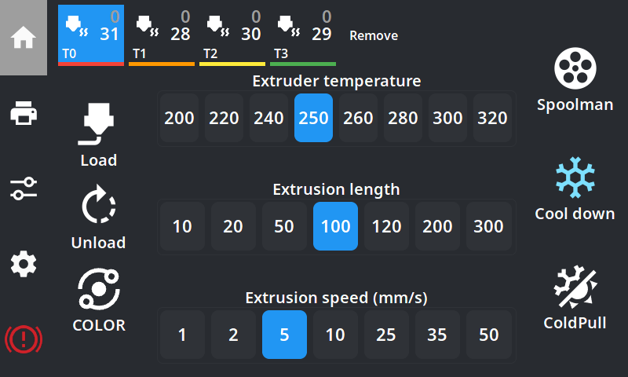
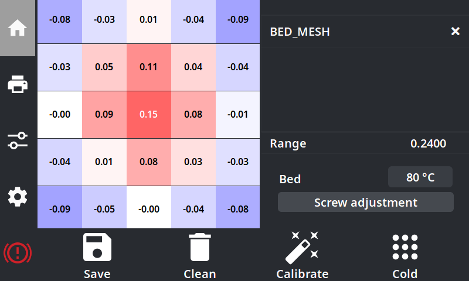
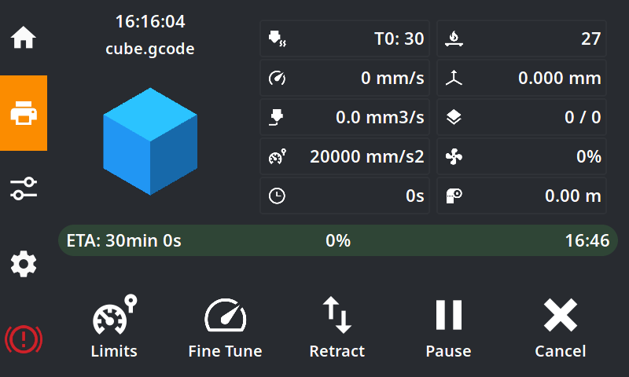
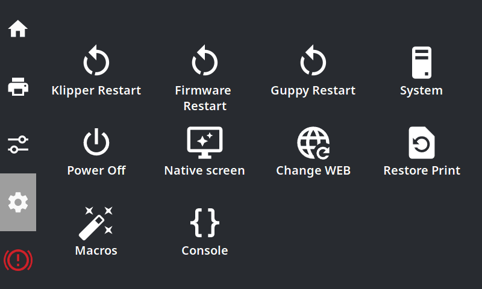

# Guppy Screen для FlashForge

[Guppy Screen](https://github.com/ballaswag/guppyscreen) — сенсорный интерфейс для Klipper и Moonraker на базе LVGL, не требующий X11 или Wayland. Этот форк адаптирован для принтеров FlashForge с [Z-Mod](https://github.com/ghzserg/zmod).

[English version](README.md)

## Поддерживаемые принтеры

- FlashForge Adventurer 5M (AD5M)
- FlashForge Adventurer 5M Pro (AD5M Pro)
- FlashForge Adventurer 5X (AD5X)
- FlashForge Creator 5 (C5)
- FlashForge Creator 5 Pro (C5 Pro)

Доступность отдельных функций определяется оборудованием принтера и объектами Klipper.

## Включение

Для работы необходим установленный **Z-Mod**. В консоли Fluidd или Mainsail выполните:

```gcode
DISPLAY_OFF
```

Guppy Screen включается по умолчанию, дополнительных параметров не требуется. Для возврата к штатному экрану:

```gcode
DISPLAY_ON
```

Перед отключением штатного экрана ознакомьтесь с настройкой карты стола, Z-offset и макросов начала и завершения печати. Настроить Wi-Fi непосредственно из Guppy Screen нельзя.

Подробнее: [DISPLAY_OFF в документации Z-Mod](https://wiki.zmod.link/ru/System/#display_off).

## Скриншоты C5 Pro

Снимки интерфейса C5 Pro (четыре экструдера) сделаны в тестовом LVGL-стенде при разрешении 800×480. На реальном принтере набор кнопок зависит от конфигурации Z-Mod.

| Главная | Печать |
|:--|:--|
|  |  |
| **Вентиляторы** | **PID** |
|  |  |
| **Экструдеры** | **Карта стола** |
|  |  |
| **Во время печати** | **Настройки** |
|  |  |

[Все экраны C5 Pro](docs/c5pro-screenshots.md)

## Возможности

Сохранены основные возможности Guppy Screen: управление температурами, перемещениями, вентиляторами и подсветкой; печать файлов, консоль, макросы, Bed Mesh, Input Shaper, калибровка ремней, Fine Tune и интеграция со Spoolman.

### Добавлено и изменено относительно ballaswag/guppyscreen

**Поддержка FlashForge и Z-Mod**

- Работа с дисплеем и сенсорной панелью FlashForge, сборки для ARM (AD5M) и MIPS (AD5X).
- Поддержка нескольких экструдеров и выбора инструмента на Creator 5 Pro; учтены четыре канала подачи с общим соплом на AD5X.
- Загрузка и выгрузка филамента через макросы Z-Mod, смена цвета (**COLOR**), **ColdPull** и переключение инструментов.
- Управление циркуляцией воздуха и заслонкой на AD5M Pro и C5 Pro: внутренняя, внешняя циркуляция и остановка.
- Доступность дополнительных кнопок определяется наличием соответствующих датчиков, вентиляторов и макросов Klipper.

**Печать и калибровки**

- **PID-калибровка** экструдера и стола с заданием температуры и выбором сопла.
- **Очистка сопла**, **сброс тензодатчиков** и отображение веса на принтерах с соответствующим датчиком.
- **Регулировка винтов стола** с помощью `BED_LEVEL_SCREWS_TUNE`.
- **Прошивочный ретракт**: настройка длины и скорости отката и обратной подачи.
- **Исключение объектов из печати** (Exclude Object) — список объектов или интерактивная карта с выбором касанием, масштабированием и перемещением.
- **Доработанная карта стола (Bed Mesh)**: отображение отклонений высоты, перемещение головки к выбранной точке карты, обычная и автоматическая полная калибровка.
- **Доработанные лимиты движения**: скорость, ускорение, Square Corner Velocity, а также `minimum_cruise_ratio` в новых версиях Klipper или `max_accel_to_decel` в старых.
- Запуск **калибровки экструдеров** и **VFA** из Tune при наличии соответствующих макросов; калибровки ремней и Input Shaper адаптированы для Z-Mod.
- Кнопки **восстановления прерванной печати**, **возврата к штатному экрану**, **переключения Fluidd/Mainsail** и выключения принтера.

**Интерфейс**

- Постоянная боковая навигация **Home / Print / Tune / Settings** с отдельной кнопкой аварийной остановки.
- Плитки температуры и датчиков с текущими и заданными значениями; для нескольких сопел — отдельные плитки и выбор инструмента.
- Синяя подсветка плитки при изменении температуры и кратковременная подсветка подтверждённых изменений в Fine Tune.
- На Home вынесены Fine Tune и Bed Mesh; консоль и макросы находятся в Settings.
- Переработан экран печати: увеличенные показания, имя файла, миниатюра, отдельная кнопка Files, широкая полоса прогресса, ETA и прошедшее время.
- Показ **текущего ограничения ускорения** на экране печати с переходом в Limits по нажатию.
- Доработана компоновка экранов для разрешения 800×480, включая Fine Tune, Limits, Retract, управление соплами и вентиляторами.
- Добавлена **регулировка яркости дисплея** из системных настроек.

**Шрифты и языки**

- Вместо стандартных шрифтов оригинального Guppy Screen используются **Noto Sans** с кириллицей и расширенной латиницей, в том числе для отображения имён файлов не только на английском языке.
- Добавлены файлы переводов интерфейса на **12 языков**: русский, английский, немецкий, французский, испанский, итальянский, португальский, чешский, турецкий, китайский, японский и корейский.
- Переводы хранятся в `.po`, а `.mo` формируются при сборке. Отображение символов зависит от набора знаков в шрифтах; полная поддержка всех письменностей не заявляется.

**Производительность и надёжность**

- Значительно снижено потребление оперативной памяти (на несколько мегабайт в сравнительных измерениях на AD5M).
- Ускорена работа интерфейса, сокращены лишние перерисовки.
- Исправлены ошибки обработки миниатюр и метаданных, обновления состояния печати, переподключения к Moonraker и работы с большими ответами.
- Добавлены автоматические тесты с имитацией Moonraker, включая проверки с ASan/UBSan.

### Отличия в составе функций

Форк рассчитан на один принтер FlashForge с Z-Mod. В этой сборке отсутствуют некоторые экраны оригинального Guppy Screen: настройка Wi-Fi, выбор другого принтера, настройка TMC и управление внешними устройствами питания. Обновление Guppy Screen выполняется средствами Z-Mod.

## Загрузка

[Релизы Guppy Screen для FlashForge](https://github.com/ghzserg/guppyscreen_ff5m/releases).

Сборки AD5M и AD5X выпускаются отдельно. Для самостоятельной сборки используются соответствующие Buildroot SDK.

## Сборка и тесты

```sh
git clone --recursive https://github.com/ghzserg/guppyscreen_ff5m.git
cd guppyscreen_ff5m
bash ci/apply-patches.sh ad5m  # либо ad5x, один раз на чистых подмодулях
make test
```

Подробнее: [сборка](ci/build-release.sh) и [тесты](docs/testing.md).

## Благодарности

**Особая благодарность [mlengle](https://github.com/mlengle)** за большой вклад в развитие интерфейса, поиск и исправление ошибок, создание автоматических тестов, проверки на реальном принтере, измерения памяти и тщательную подготовку изменений.

Спасибо [ballaswag](https://github.com/ballaswag/guppyscreen) и участникам оригинального Guppy Screen, а также разработчикам [LVGL](https://github.com/lvgl/lvgl), [Klipper](https://github.com/Klipper3d/klipper) и [Moonraker](https://github.com/Arksine/moonraker).

[Лицензия](LICENSE) · [Сравнение с оригиналом](https://github.com/ballaswag/guppyscreen/compare/main...ghzserg:main)