# Скриншоты Guppy Screen — C5 Pro

Снимки сделаны **тестовым LVGL-стендом 800×480** с фикстурой C5 Pro (четыре экструдера, вентиляторы камеры). Это не фотографии реального принтера. Доступность кнопок на устройстве зависит от его конфигурации Z-Mod и Klipper.

Screenshots are captured from the **800×480 LVGL test framebuffer** using the C5 Pro fixture. They are not photos of the printer. Controls shown depend on the printer configuration.

Экран LED не включён: в тестовой конфигурации C5 Pro нет управляемых светодиодов, поэтому эта панель пустая.

Сценарий: [`ci/ui-scenarios/c5pro-gallery.txt`](../ci/ui-scenarios/c5pro-gallery.txt). Обновление изображений — только вручную через GitHub Actions → **Rebuild C5 Pro gallery** → **Run workflow** (выбрать ветку). Локально: `bash ci/generate-c5pro-gallery.sh` после установки зависимостей и применения патчей. Для Input Shaper необходимы `tests/fixtures/resonances_X.png` и `tests/fixtures/resonances_Y.png`.

| **Главная / Home** | **Файлы / Print** |
|:--|:--|
| 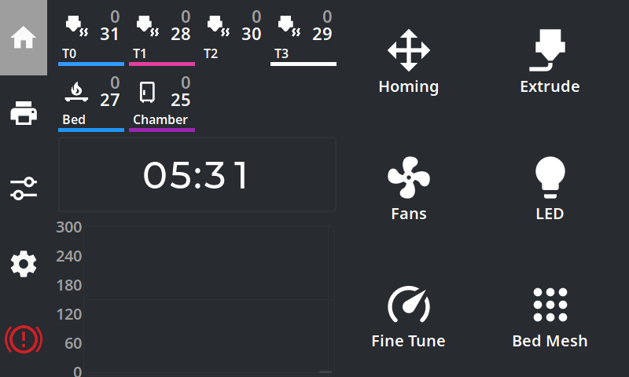 |  |

| **Настройка / Tune** | **Настройки / Settings** |
|:--|:--|
| 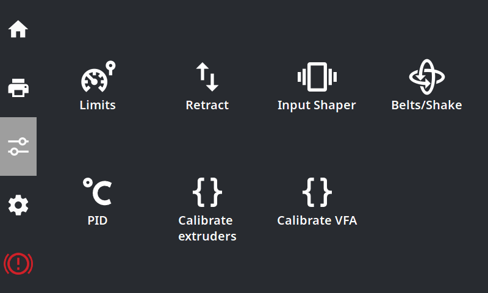 | 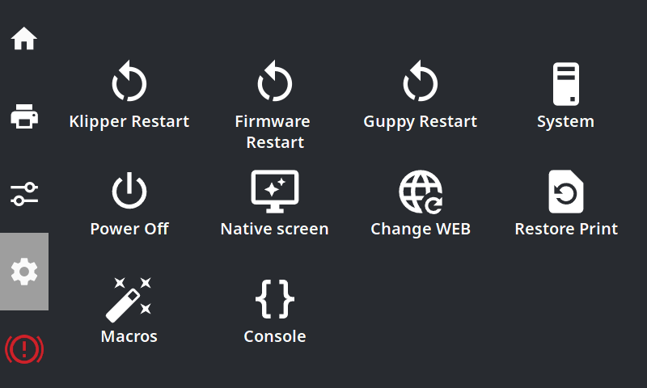 |

| **Просмотр файла / File preview** | **Идёт печать / Printing** |
|:--|:--|
| 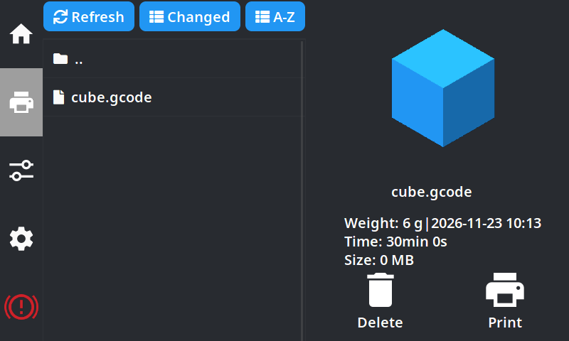 | 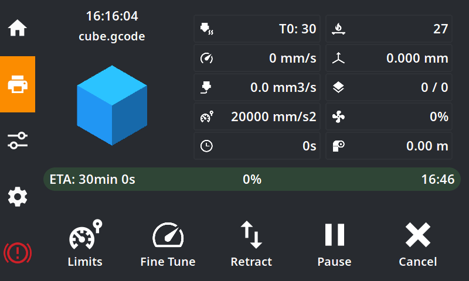 |

| **Пауза / Paused** | **Главная при печати / Home while printing** |
|:--|:--|
| 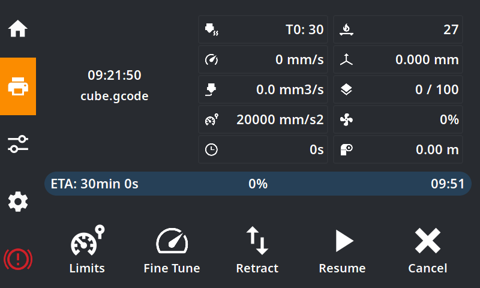 | 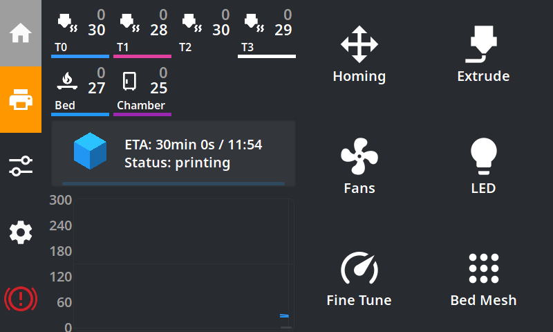 |

| **Главная на паузе / Home while paused** | **Исключение объектов / Exclude map** |
|:--|:--|
| 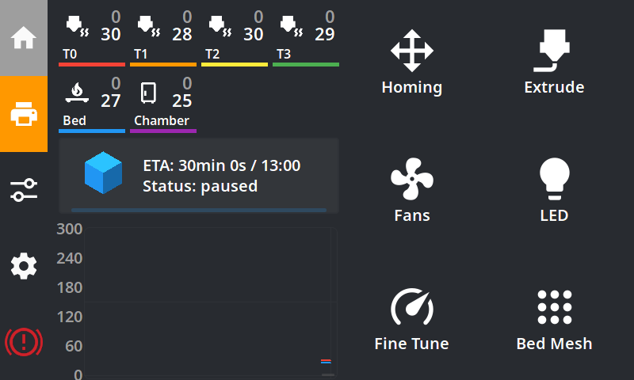 | 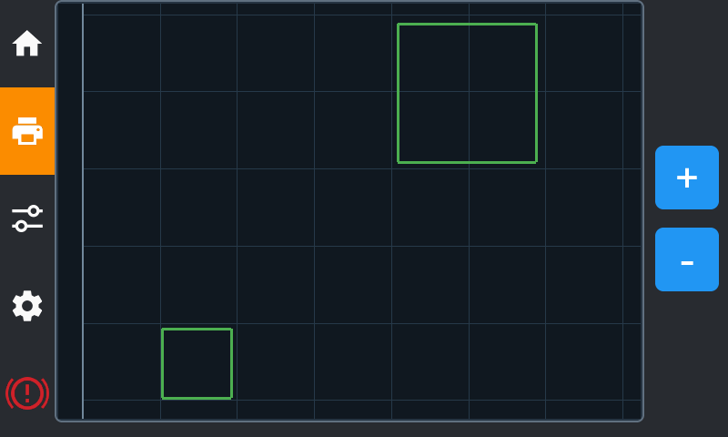 |

| **Парковка / Homing** | **Экструдеры / Extrude** |
|:--|:--|
| 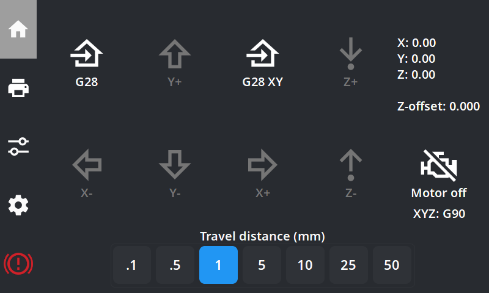 | 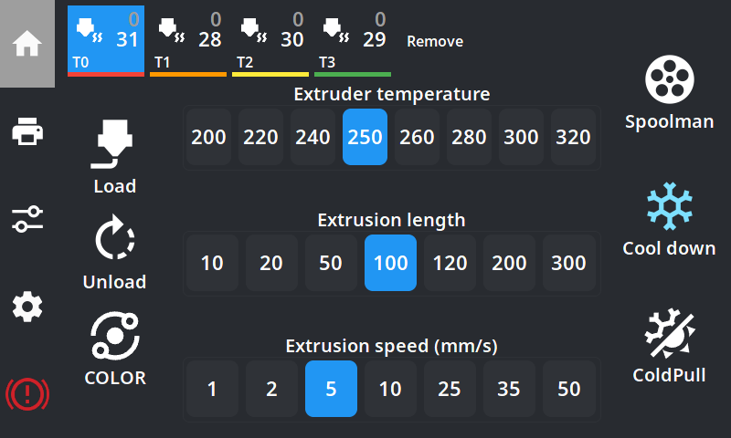 |

| **Вентиляторы / Fans** | **Точная настройка / Fine Tune** |
|:--|:--|
| 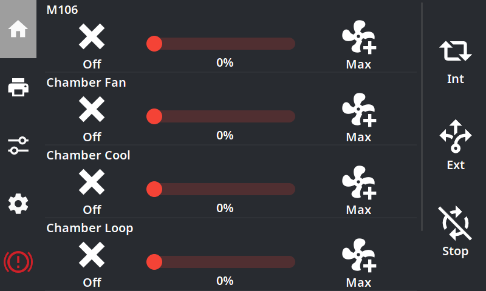 | 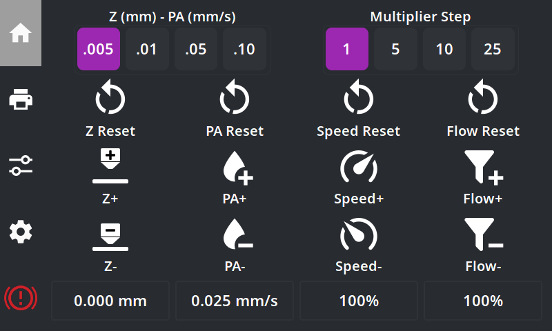 |

| **Карта стола / Bed Mesh** | **Лимиты / Limits** |
|:--|:--|
| 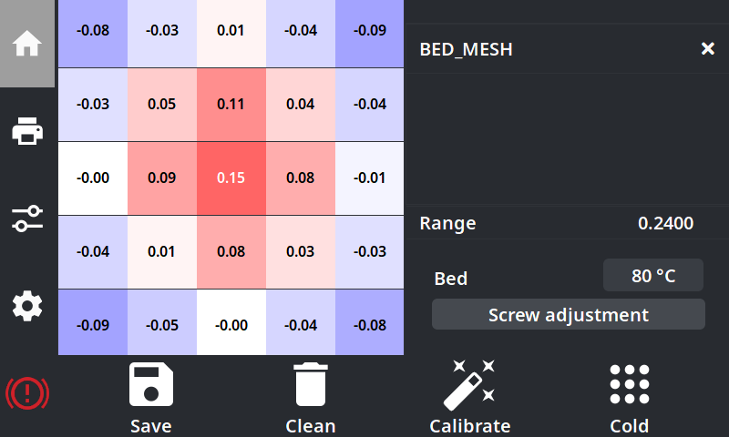 | 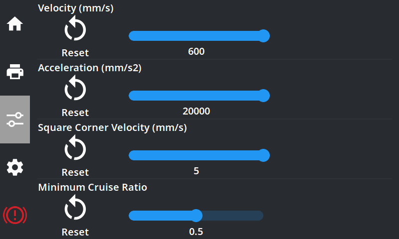 |

| **Ретракт / Retraction** | **Input Shaper** |
|:--|:--|
| 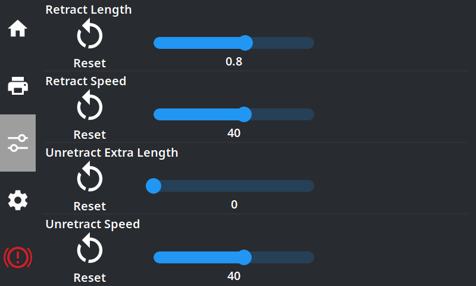 | 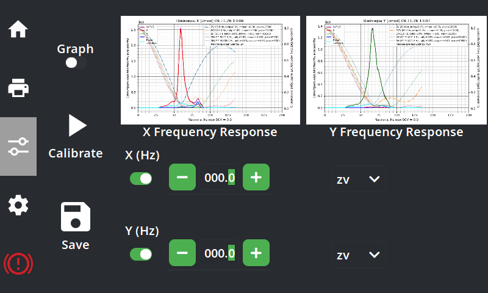 |

| **Ремни / Belts** | **PID** |
|:--|:--|
| 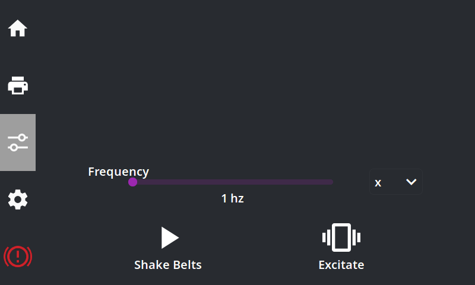 | 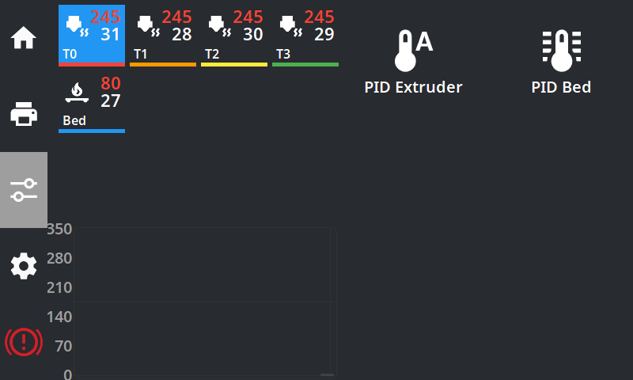 |

| **Система / System** | **Макросы / Macros** |
|:--|:--|
| 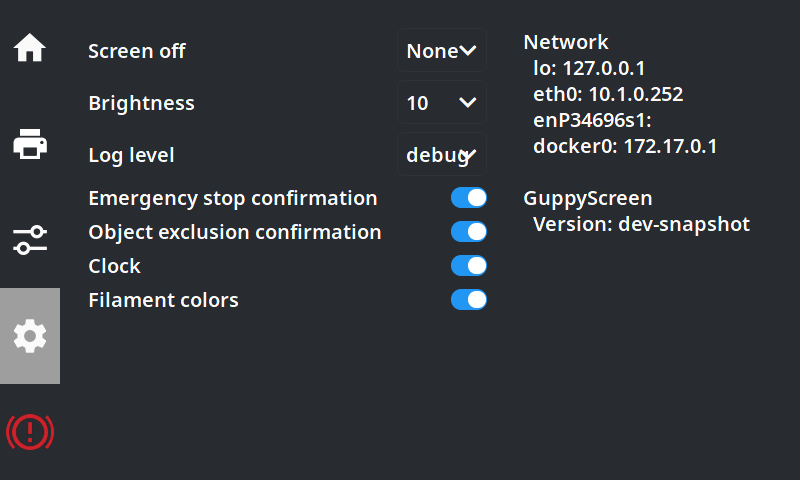 | 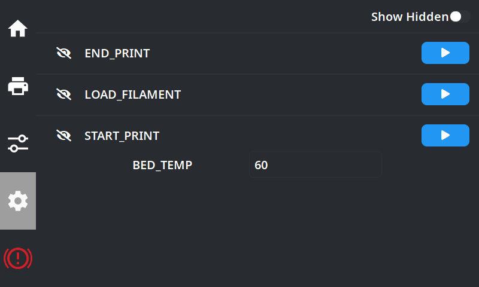 |

| **Консоль / Console** | |
|:--|:--|
| 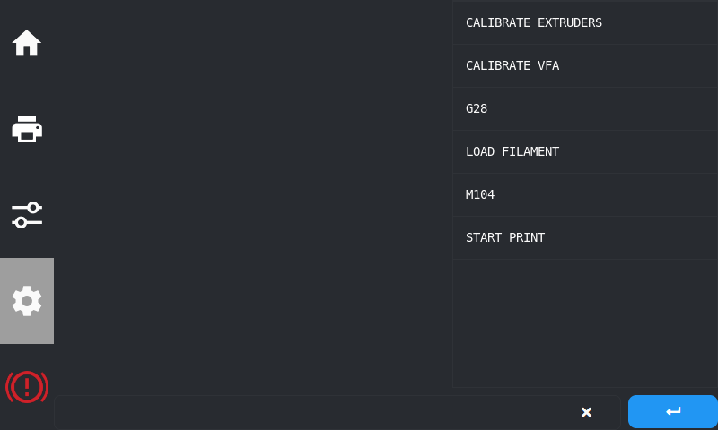 | |

